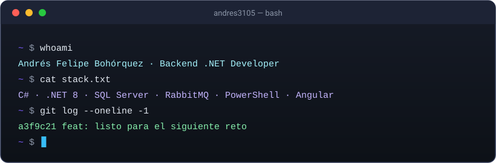

<!--
  Andrés Bohórquez · GitHub Profile README
  Desarrollador Backend (.NET) · Bogotá, Colombia
  Los SVG de /assets son autocontenidos y animados (SMIL): no dependen de servicios externos.
-->

 

<!-- Descomenta y completa con tus datos reales:

&nbsp;

&nbsp;
-->

&nbsp;

&nbsp;

 

---

## ◈ &nbsp;Sobre mí

Tecnólogo en Análisis y Desarrollo de Software e Ingeniero de Sistemas en formación. Trabajo en desarrollo backend con **C# y .NET**, integración de sistemas con **APIs REST y RabbitMQ**, procedimientos almacenados en **SQL Server** y automatización de despliegues con **PowerShell**. También tengo experiencia en automatización de pruebas y en gestión de datos. Aprendo rápido, me gusta el trabajo en equipo y comunico con claridad.

> *"La disciplina y la constancia superan al talento."*

 

---

## ◈ &nbsp;Tecnologías

 

---

## ◈ &nbsp;Lo que construí

Construí desde cero el XML de factura electrónica bajo **UBL 2.1** y los requisitos de la **DIAN**, con mapeo de DTO y validación de XML y JSON. Los workers procesan de forma asíncrona, consultan estados, manejan excepciones y reintentan; los datos salen de procedimientos almacenados en SQL Server.

 

---

## ◈ &nbsp;Experiencia

<table width="100%">
<tr>
<td width="140px" valign="top" align="center">

**Abr 2026** **— Nov 2026**

</td>
<td valign="top">

### Sistran Colombia S.A &nbsp;·&nbsp; Analista Programador

Participé en la adaptación del componente de facturación electrónica de **SBS Seguros**, integrando al proveedor Estupendo con **C#, .NET Framework y .NET 8**. Desarrollé y adapté librerías y workers con **APIs REST y RabbitMQ**, y escribí procedimientos almacenados y scripts **T-SQL** para extraer y validar información según las reglas de cada modalidad de facturación. Creé herramientas en **PowerShell** para instalar, configurar y desinstalar aplicaciones, servicios Windows y sitios en IIS. Hice pruebas de integración, depuración con logs y control de cambios con Git y Azure DevOps.

`C#` &nbsp;`.NET 8` &nbsp;`RabbitMQ` &nbsp;`SQL Server` &nbsp;`PowerShell` &nbsp;`UBL 2.1` &nbsp;`Azure DevOps`

</td>
</tr>
<tr><td colspan="2"> </td></tr>
<tr>
<td width="140px" valign="top" align="center">

**Nov 2024** **— Oct 2025**

</td>
<td valign="top">

### Sistran Colombia S.A &nbsp;·&nbsp; Estudiante de Programación

Desarrollo de software con enfoque en **APIs REST** y automatizaciones en **n8n**. Gestión de Git (ramas, merges, pull requests) para asegurar trazabilidad. Automaticé pruebas en **C#** integradas con Azure DevOps, con ejecución iterativa de casos de prueba y reportes automáticos, y pruebas con **Selenium WebDriver** en Visual Studio. Documenté casos de prueba, historias de usuario, tareas y bugs en Azure DevOps.

`C#` &nbsp;`Selenium` &nbsp;`Azure DevOps` &nbsp;`n8n` &nbsp;`Git`

</td>
</tr>
<tr><td colspan="2"> </td></tr>
<tr>
<td width="140px" valign="top" align="center">

**Dic 2023** **— Jun 2024**

</td>
<td valign="top">

### Banco Popular S.A &nbsp;·&nbsp; Practicante Gobierno de Datos

Actualicé archivos de datos de referencia para garantizar su precisión y mantuve la calidad de los datos según las reglas establecidas. Apoyé la actualización del modelo de gobierno de información, preparé informes de calidad de datos con tableros de control y colaboré en pruebas de calidad de datos críticos junto con líderes de dominio.

`Calidad de datos` &nbsp;`Gobierno de datos` &nbsp;`Tableros` &nbsp;`Excel`

</td>
</tr>
</table>

 

---

## ◈ &nbsp;Educación

| Período | Institución | Título |
|:---|:---|:---|
| En curso · Octavo sem. | Corporación Universitaria Minuto de Dios | Ingeniería de Sistemas |
| 2024 | SENA | Tecnólogo en Análisis y Desarrollo de Software |
| 2022 | SENA | Técnico en Programación de Software |

 

---

## ◈ &nbsp;Formación complementaria

| Curso | Institución | Año |
|:---|:---:|:---:|
|  | SENA | 2023 |
|  | SENA | 2023 |
|  | SENA | 2022 |

 

---

## ◈ &nbsp;Proyectos destacados

### Arquitectura de Microservicios (.NET)
Microservicios desacoplados que se comunican entre sí, contenerizados con Docker y pensados para escalar y mantenerse con facilidad.
`C#` · `.NET` · `Docker` · `Microservicios`

---

### Pokedex App
Aplicación que consume APIs y maneja datos dinámicos, con integración frontend-backend y una estructura clara entre lógica y presentación.
`Consumo de APIs` · `Frontend` · `Backend`

---

### Automatización de Reportes (Excel)
Macros que generan archivos de forma automática: filtran, transforman y estructuran datos para reemplazar procesos manuales.
`Excel` · `Macros` · `Automatización`

 

---

*Bogotá, Colombia &nbsp;·&nbsp; abierto a oportunidades como desarrollador backend*

